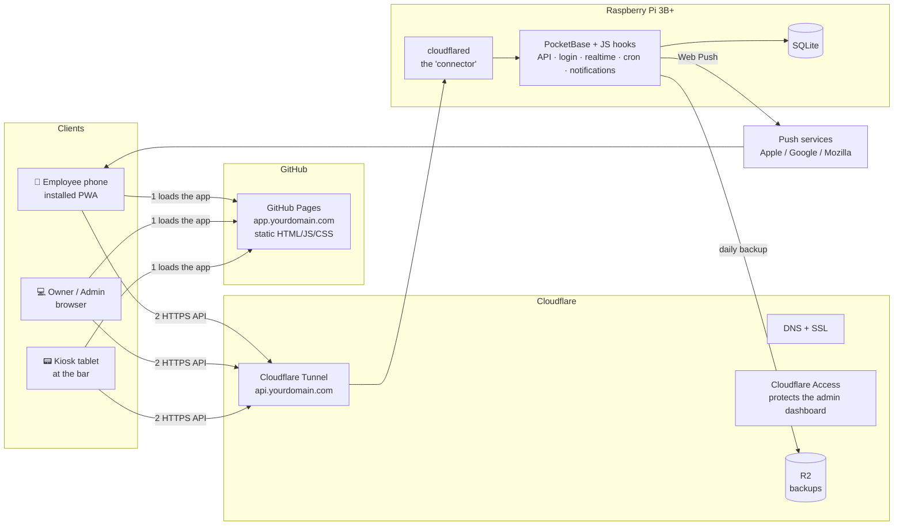
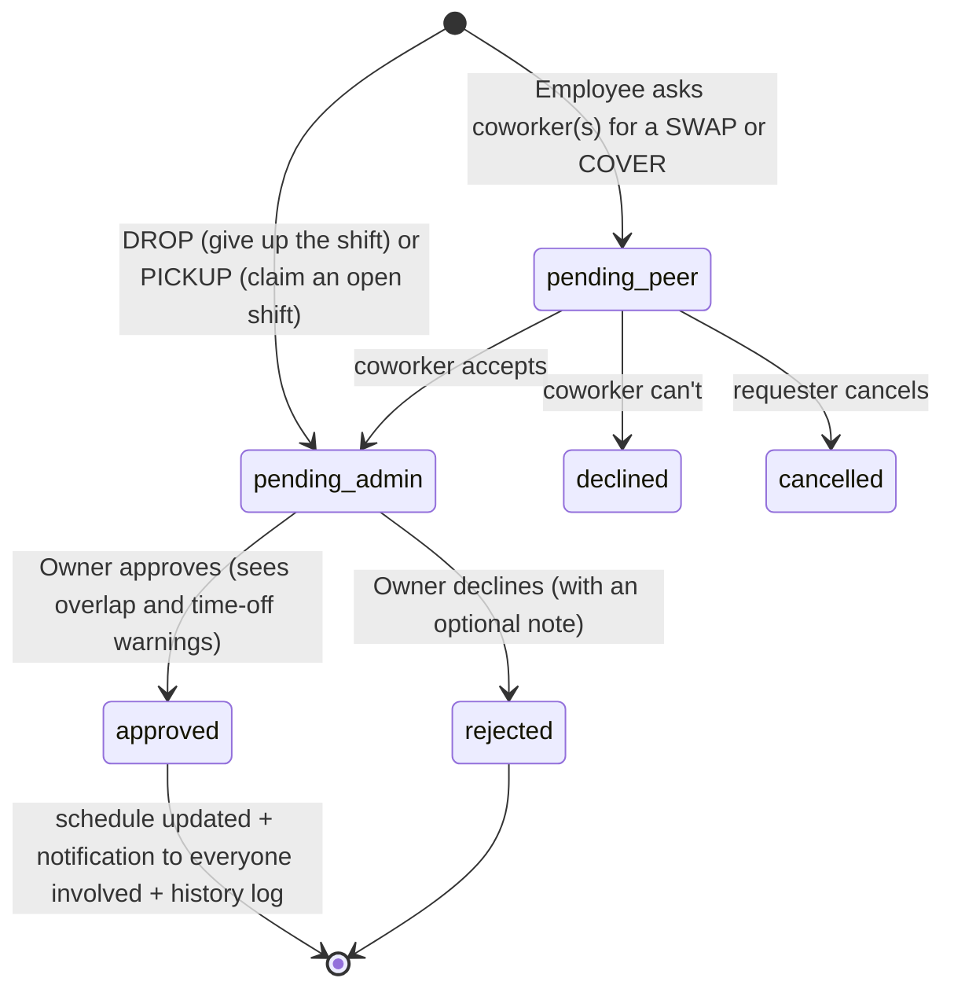

# Project "Crewdeck": full Homebase research and the design of our in-house system

> **Date:** Nov 16, 2026
> **Goal:** understand in depth what [Homebase](https://www.joinhomebase.com) does, how it does it and how it models things; collect its users' complaints; and design our own in-house version for the bar, running on **GitHub Pages + our domain + Raspberry Pi 3B+ + Cloudflare (Tunnel / "connector")**.
>
> **How sure each fact is:**
> - ✅ = confirmed on an official Homebase page (website or help center)
> - 🟡 = reported by third parties (reviews, App Store, Trustpilot, competitors)
> - 🔵 = our own inference or proposal
>
> **Update (Nov 17, 2026):** the MVP is built and named **Crewdeck**. It's fully in English and designed like a native Apple (iOS) app. Deployment changed: the app and the API are both served from the Pi (next to GiraBoard) at **scheduler.hackxolotl.com** through the existing Cloudflare Tunnel; GitHub Pages is no longer used. See `DEPLOYMENT.md`.

---

## Contents

0. [Quick summary](#0-quick-summary)
1. [What Homebase is, plans and pricing](#1-what-homebase-is-plans-and-pricing)
2. [How it models things (conceptual model)](#2-how-it-models-things-conceptual-model)
3. [Every module in depth](#3-every-module-in-depth)
4. [Homebase screen and navigation map](#4-homebase-screen-and-navigation-map)
5. [Complaints and requests from real users](#5-complaints-and-requests-from-real-users)
6. [Your notes turned into requirements](#6-your-notes-turned-into-requirements)
7. [Our product scope: what we copy, improve and do NOT do](#7-our-product-scope)
8. [Concrete improvements over Homebase](#8-concrete-improvements-over-homebase)
9. [Architecture: GitHub Pages + Pi 3B+ + Cloudflare](#9-architecture-github-pages--pi-3b--cloudflare)
10. [Proposed data model](#10-proposed-data-model)
11. [Business rules and flows (state machines)](#11-business-rules-and-flows)
12. [Proposed roles and permissions for the bar](#12-proposed-roles-and-permissions-for-the-bar)
13. [Phased roadmap](#13-phased-roadmap)
14. [Risks, legal topics and honest limitations](#14-risks-legal-topics-and-honest-limitations)
15. [Open questions for you](#15-open-questions-for-you)
16. [Sources](#16-sources)

---

## 0. Quick summary

- **Homebase** is an "all-in-one" app for small businesses with hourly workers: **scheduling, GPS time clock, timesheets, messaging, time-off requests, shift trades, payroll, hiring, HR, tips, tasks and earned wage access**. ✅
- It charges **per physical location**: free up to 10 employees at 1 location, then **$30 / $70 / $120 USD per month per location**, plus add-ons (tips $25, tasks $13, payroll $49 + $6 per employee, etc.). ✅
- Its big design idea: **it separates "access level" (Owner / General Manager / Manager / Employee) from "role" (bartender, barback…)**. We copy that separation. ✅
- What users complain about most: **a rigid geofence (only 150 ft / 1 block / 5 blocks), GPS blocking people who are actually on site, offline mode that doesn't work, lost notifications, reports that can't be customized, limited messaging, per-location pricing with add-ons that pile up, and slow bot-first support**. 🟡
- **Our version:** a PWA (installable web app) on **GitHub Pages**, with the backend on the **Pi 3B+** using **PocketBase** (one binary: SQLite database, login, realtime and files). The Pi is published to the internet with **Cloudflare Tunnel** (no router ports opened) at `api.yourdomain.com`. Backups go to Cloudflare R2. Monthly cost ≈ **$0** plus power and the domain. 🔵
- **Your key rules:** every shift change and open-shift pickup is **always** approved by **the owner** (owner only since Nov 18, 2026); positions GM, AM, Bartender, Barback, Cocktail and Bouncer; GPS when clocking in; schedules; time off; a location with 4 sections; **anyone** must be able to use it easily.

---

## 1. What Homebase is, plans and pricing

### 1.1 Positioning ✅
- Tagline: *"Schedule. Manage. Pay. All from one easy app."*
- Company: Pioneer Works, Inc. (developer name on the App Store).
- They claim **150,000+ businesses** and **3.5M workers**, with **4.8★ on the App Store** (about 92–98 thousand ratings) and **4.6★ on Capterra**.
- Industries: Food & beverage, Retail, Beauty & wellness, Medical & veterinary, Home & repair, Services, Hospitality & leisure, Education & caregiving. The hiring section explicitly mentions **"bars and breweries"**.
- Products in the menu: Scheduling, Time clock, Timesheets, Payroll, Hiring & onboarding, HR & compliance, AI Assistants, Hiring Assistant, Team communication, Task manager, Tip manager, Integrations, Mobile App and Cash Out.
- Free marketing tools: schedule maker, time card calculator, hourly wage calculator, labor cost calculator, state labor law guides and comparisons.

### 1.2 Plans (price per **location** per month, Nov 2026) ✅

| Plan | Monthly | Yearly (−20%) | Employees | What it adds |
|---|---|---|---|---|
| **Basic** | $0 | $0 | Up to **10**, **1 location** | Basic scheduling, basic time clock, POS integration, payroll as an add-on |
| **Essentials** | $30 | ~$24 | Unlimited | + Advanced scheduling, advanced time clock (**GPS/geofence**, tablet photo), team communication, payroll integrations |
| **Plus** | $70 | ~$56 | Unlimited | + **AI scheduling assistant**, PTO / time-off controls, **departments and custom permissions**, early clock-in prevention, overtime alerts, auto clock-out, child labor compliance |
| **All-in-One** | $120 | ~$96 | Unlimited | + Onboarding without payroll, HR and compliance (certified advisors, employee handbook), custom documents |

> Note: the yearly prices come from third-party sites (Connecteam, Costbench). The official page only shows one price per plan with a "Save 20%" label. 🟡

**What each row of their comparison table includes** ✅ (grouped the way they group it):
- **Scheduling and time clock basics:** build the weekly schedule; request **unpaid** time off; clock in on tablets, computers and POS; keep time cards for **90 days** (on paid plans, **4+ years**); trade, cover and pick up open shifts.
- **Employee management:** real-time messaging; Cash Out (earned wage access) at no cost to the business; mobile app.
- **Advanced scheduling and time clock:** manage availability; location-based clock-in (geofence); photo when clocking in on a tablet/POS; overtime and break preferences; automatic clock-in and clock-out reminders; payroll integrations.
- **Team communication:** events and notes per shift; custom channels and announcements; read receipts for schedules and messages.
- **Retention and performance:** attendance with reports and **late alerts**; birthdays and work anniversaries; employee certifications; performance notes.
- **Departments and permissions:** assign managers and general managers; custom permissions for each; departments.
- **Business insights:** activity, sales and labor cost reports; scheduling based on **forecast sales and labor cost targets**; an API for custom integrations.
- **Time off and break waivers:** break waivers; team time-off board; **blackout dates** for time-off requests; **required advance notice**; PTO policies with automatic accrual.
- **Labor cost:** alerts when approaching overtime; **prevent early clock-in or early return from break**; **auto clock-out at the end of the shift**; salaried employees and **multiple hourly rates**.
- **Onboarding** (with payroll): packets for new hires and contractors; W-4, W-9, I-9 and direct deposit; e-signature; document storage.
- **HR and compliance:** live support from HR advisors; policy review and a custom handbook; alerts about labor law changes.

### 1.3 Add-ons sold separately ✅

| Add-on | Price |
|---|---|
| **Payroll** | $49/month + **$6 per paid employee** (current promo: 6 months free; the base used to be $39) |
| **Tip Manager** | **$25/month per location** |
| **Task Manager** (tasks and checklists) | **$13/month per location** |
| Background checks | $30 each |
| Job post boosts | from $50 per post |
| **Hiring Assistant** (AI hiring) | $99/month yearly or $199/month with no contract |
| Cash Out | free for the business (the employee pays $4.99 for an instant deposit) |

- "**Location**" = a physical address. Two addresses in the same city are two locations and are billed separately. ✅
- 14-day All-in-One trial; if you don't pick a plan, you drop back to Basic. ✅

### 1.4 What Homebase would cost us (quick estimate) 🔵
A bar with more than 10 employees that wants permissions, time-off approval, tips and tasks needs **Plus ($70) + Tips ($25) + Tasks ($13) = $108 USD per month per location**, without payroll. With 4 locations that's **~$432 per month (~$5,200 per year)**. Our version costs practically $0 per month.

---

## 2. How it models things (conceptual model)

### 2.1 The hierarchy ✅ (with modeling details 🔵)

```
Account / Company (1 Owner, same FEIN and pay calendar)
└── Location (physical address · time zone · plan · 1 geofence · its own settings)
    ├── Departments (e.g. Bar, Floor, Security)
    │   └── Roles = positions (e.g. Bartender, Barback)
    ├── Team members
    │   ├── Access level: Owner | General Manager | Manager | Employee  (+ Payroll Admin, HR Pro)
    │   ├── Roles and wages PER LOCATION (one wage per role or a default one)
    │   ├── Default role
    │   ├── Clock-in PIN
    │   └── Profile: emergency contact, payroll data, performance notes, certifications, birthday
    ├── Schedule (per week)
    │   └── Shifts (draft or published · role · department · notes · unassigned open shift)
    ├── Time cards (clock-ins and clock-outs · breaks · GPS snapshot · selfie · tips · notes · lock · edit history · "issues")
    ├── Requests (time off · availability · trade · cover · pick up open shift)
    ├── Messages (DM · groups · whole company · announcements with read receipts)
    ├── Manager log · Tasks · Tip pools
    └── Reports
```

### 2.2 Key concepts worth copying
1. **Access level ≠ role.** The access level says **what you can do in the system** and the role says **what job you do and how much you earn**. A "General Manager" role usually has "General Manager" access, but they're two separate fields. ✅
2. **Everything is per location:** roles, wages, time clock settings, geofence (one per location), required breaks (with an "apply to all locations" button) and weather (by ZIP code). ✅
3. **Role priority on the time card:** the profile's default role → the scheduled shift's role → whatever the manager types. ✅
4. **Blended rate:** if someone worked two roles with different wages in the same week, overtime and PTO are paid at the weighted average. Official example: 20 h at $14 + 10 h at $17 = $450 / 30 h = **$15/h**. ✅
5. **Configurable work week:** start day and time. Used to calculate overtime. ✅
6. **Visible states everywhere:**
   - Shift: **draft** or **published** (nothing goes out until you hit "Publish").
   - Time card: **"Needs review"** or **"Looking good"**, **locked** or **unlocked**.
   - Request: **pending**, **accepted by the coworker and waiting for final approval**, **approved** or **declined**.
7. **GPS = a snapshot, not tracking.** Location is only saved when clocking in, clocking out and on breaks. ✅

---

## 3. Every module in depth

### 3.1 Scheduling ✅
- **Drag & drop builder**, included for free. **Weekly** and **daily** views (users ask for a monthly view 🟡).
- **Templates:** created from the week you're looking at (Gear → "Manage templates" → name → Create). **Weekly only.** Applying one creates **drafts** until you publish. Deleting a template can't be undone.
- **Copy week:** Gear → "Copy week to" → target week → scope (**everything, certain departments, certain roles or certain people**) → edit → Publish.
- **Open shifts**, unassigned, that people can claim.
- **Notes per shift** and **company events** on the schedule.
- **Conflict detection**: double shifts, pending time off, missing availability.
- **Live labor cost** while you build the schedule, and overtime alerts **before publishing**.
- **Sales forecast vs labor** (Plus+), in a bar that expands below the schedule:
  - **Weather** (by the location's ZIP code).
  - **Sales** (average of the last 2 weeks by weekday; from the POS if connected or entered by hand; editable).
  - **Labor cost % target** per day or per week.
  - Per department.
  - **Sales and labor per hour** (needs a POS): works out how many people you need for your target and charts it below the schedule.
  - Manual sales: upload a CSV with Date and Value columns.
- **Publishing** notifies by **text, email and in-app notification**. ✅
- **Confirmation that people saw the schedule** (Plus+). ✅
- **Automatic shift reminders** (Plus+). One user mentioned a text one hour before. 🟡
- **Calendar sync:** Google Calendar, Apple (iCal) and others, turned on by the employee in the app. ✅
- **Upload a photo or screenshot** of your current schedule so AI digitizes it at sign-up. 🟡 One review says it added the people but **didn't read shifts or roles**.

#### AI Schedule Builder ("Scheduling Assistant", Plus+) ✅
- **Web only**, and only for managers and owners. **It only appears on an empty, unpublished week.** Buttons: "Build my draft schedule" or "Build schedule manually".
- Uses **roles and 5 weeks of history**, and scores every eligible person for every shift.
- **Rules:** never schedules outside approved availability or anyone terminated; respects which roles each person can work; **avoids closing then opening ("clopening")**; keeps hours close to each person's average (prefers giving an extra shift over being short-staffed).
- **Conflicts panel:**
  - Block publishing: **Pending time off**, **Overtime**, **Insufficient rest** (clopening) and **No coverage available**.
  - Warning only: **Missing availability**.
- You can go back to the previous view from the three-dot menu.

### 3.2 Shift changes: trades, covers and open shifts ✅
- **Trade:** two people swap shifts. **Cover:** someone takes your shift.
- The employee sends the request to **all eligible coworkers** or to **specific people**.
- **Eligibility filter:** excludes anyone without the role, already scheduled, or with approved time off at that time.
- **Configurable policies:** allow only "even" trades (same hours, pay or role), **minimum notice** (they recommend 24–48 h) and checks for overtime and minimum rest between shifts.
- **Flow:** employee asks → coworker accepts → **"accepted, pending manager final approval"** → manager approves or declines → schedule and labor cost update automatically.
- The manager sees the **overtime alert and the estimated pay before approving**. They approve from the **bell** on the web or from **Requests** on the phone.
- If nobody accepts, **the original employee stays scheduled**. The manager can post the shift as open, and anyone who already declined isn't offered it again.
- **Open shifts:** first come, first served. Depending on settings, **it's assigned automatically or waits for approval**.
- The history of every request is kept.
- In the app, the employee can send a **"Find Cover"** request from chat.

### 3.3 Availability and time off (PTO) ✅
- The employee sets their **availability** from the phone. It can require **manager approval** (a separate permission).
- **Time off:** on Basic, only **unpaid**. On Plus+ there are **PTO policies** (vacation and sick) with **automatic accrual and balances**.
- **Controls:** **blackout dates**, **a limit of requests per date** and **required minimum notice**.
- **Team time-off board.**
- Approved time off goes onto the schedule automatically, and PTO is added to the timesheet (PTO or Sick column).
- Warns about conflicts when approving.
- **What's missing** (🟡 BuddyPunch): you can't leave **a note when approving or declining**; the employee can request **more days than they have** with no warning; PTO policies are per person or for everyone, **not per role, location or department**.

### 3.4 Time clock ✅

**Ways to clock in:**

| Mode | How it works | Plan |
|---|---|---|
| **Employee's phone** | Clocks in from their app, with GPS and geofence | Geofence on Essentials+ |
| **Tablet / kiosk** | Separate "**Time Clock by Homebase**" app (iOS/Android, not Amazon Fire). The manager signs in and each employee clocks in with a **PIN**. Optional: the employee signs in with a one-time code | Basic+ |
| **Shared web** | The business computer + PIN | Basic+ |
| **Personal web** | From their own signed-in computer, no PIN | optional |
| **POS** | Clover, Square, Toast, Shopify and others | per integration |
| **Offline** | They say it saves and syncs later. 🟡 **Third-party tests say it didn't work** | — |

**GPS and geofence** ✅
- **One geofence per location**, around the business address.
- **Only 3 possible radii: 150 ft (~46 m), 1 block or 5 blocks.**
- Only applies when clocking in from the phone. Outside the geofence, **it blocks and alerts the manager**.
- A **GPS snapshot** is taken on clock-in, clock-out and every break. **No continuous tracking and no live map.**
- Setting: "**Allow unscheduled shift clock-in from the mobile app**".

**Anti-fraud ("buddy punching")** ✅
- **Unique PIN** per employee.
- **Selfie** with the front camera when clocking in on a tablet, also on breaks (the help center says Plus+ and the pricing page says Essentials; they contradict each other).
- Alert if someone clocks in for a coworker before they arrive.

**Schedule Enforcement** (Settings → Scheduling → Schedule Enforcement) ✅
- "**Prevent early clock in X minutes before the shift**": applies on tablet, phone, web and some POS. **Employee level only**; managers and GMs aren't blocked.
- "**Prevent early clock in from breaks**": you can't come back before the break ends.
- **Clock out reminder:** a reminder 10 min after a missed clock-out. The time they respond counts as their clock-out.
- "**Automatically clock out employees X mins after their scheduled shift ends**".
- **Assisted clock-in/out:** several push notifications at **10 min, 1 h, 2 h and 14 h** after the shift (the 14 h one only for shifts that start **after 8 pm** — very bar-like). The employee enters their real time and a reason. Those within 15 min after the shift are **approved automatically**. The rest go to the manager in "Daily Review".
- 🟡 Early clock-in blocking is **off by default**: in one test someone **clocked in 3 days early**.

**Other time clock settings** ✅
- **Shift rating** from 0 to 5 stars plus a comment on clock-out (shown in Reports).
- **Record cash tips on clock-out** (editable later).
- **Rounding:**
  - To 5 min: 1–2 min rounds down and 3–4 rounds up.
  - To 15 min: 1–7 rounds down and 8–14 rounds up.
- A switch to **turn off all time tracking**.

### 3.5 Breaks and compliance ✅
- Configurable **required breaks**. Unpaid ones are subtracted from scheduled hours (a 9 h shift with 1 h unpaid = 8.00 h).
- **Break waivers:** the employee can **waive** a required break if allowed ("Employee can waive" on their profile). On clock-out they're asked whether to edit or waive breaks they didn't take.
  - California limits: breaks can **not** be waived on **6–10 h** shifts or **over 12 h**. They **can** be waived on **5–6 h** or **10–12 h** shifts.
  - With waivers on, auto clock-out, adding breaks after clock-out and missed-clock-out text messages must be off.
- **Missed break corrections**, "convert excess paid break time into unpaid" and "**pay overtime for a missed break**" (break penalty). All editable.
- List of **"highly regulated" states**: CA, CO, CT, DE, IL, KY, ME, MD, MA, MN, NE, NV, NH, NJ, NY, ND, OR, RI, TN, VA, VT and WA.

### 3.6 Timesheets ✅
- **Two views:** **Daily Review** (recent) and **Pay Period Review** (the whole team by range; at most **31 days**). Quick ranges: current period, previous, today, yesterday and custom.
- **Group** by date, person or role. Show or hide columns, and hide people with no hours.
- **Issues, by priority:**
  1. Missing clock-out.
  2. Unscheduled or mismatched shifts.
  3. **No-shows**.
  4. Required breaks not taken.
- Everything is grouped into **"Needs review"** and **"Looking good"**, and can be **resolved in bulk**.
- **Resolving a no-show:** "add hours as scheduled" (forgot to clock in), "add an absence reason" (reasons **can't be customized**) or make another edit.
- **Adding or editing a time card:** employee, date, role (you can create a new one), clock-in, clock-out and breaks, plus a **manager note**.
- **Lock:** the owner or manager **locks** a reviewed time card ("Lock All" for all of them). The **edit history** shows who locked and unlocked it.
- **Columns:** Role, Wage Rate, Time Card, Issues, Scheduled Hours, Actual Hours, Actual vs Scheduled, Total Paid Hours, Regular, Unpaid Breaks, **OT**, **Double OT**, Spread of Hours, Split Shifts, Estimated Wages, **Cash Tips**, **Credit Tips**, Blue Law Hours, **Holiday Pay**, **PTO**, **Sick** and Qualified OT (overtime tax report).
- **Notes on the time card** between employee and manager.
- **Exports** to XLS, CSV, PDF and payroll provider formats. 🟡 The employee can only download **PDF**.
- Retention: **90 days** on Basic and **4+ years** on paid plans.

### 3.7 Overtime, holidays, minors and labor law ✅
- **Daily and weekly overtime** with configurable threshold and multiplier.
  - US defaults: **>8 h a day**, **>40 h a week**, 7th consecutive day, and **double time** in California.
  - "**Track overtime across multiple locations**": 34 h at A + 10 h at B = 4 h of overtime.
- **Salaried employees** under a certain threshold also earn overtime (two different figures appear, $35,568 and $43,888; their own documentation doesn't match).
- **Alert managers** when someone goes into overtime (email, push or text).
- **Holiday pay rates:** a multiplier on specific dates, only if they work that day (not paid holidays).
- **Child labor laws** (Plus+): checks age, school days and state and federal rules **before publishing**, and applies the most protective rule.
- **Predictive scheduling / Fair workweek** (14-day notice and premium pay for changes in SF, NYC, Seattle, Chicago, Oregon…): Homebase **mentions it on its blog**, but we found no documentation of a feature that calculates the premium pay.

### 3.8 Team communication ✅
- **Messages** 1-on-1, by group and company-wide, **without sharing phone numbers**. New hires are added to the team automatically.
- **Instant groups**, for example "everyone working today" or "everyone with keys".
- Messages to **departments, locations or the whole company**.
- **Inside the chat:** share location, gallery, camera, **"Find Cover" request**, GIFs (/giphy), **polls**, threaded replies, **@mentions** and **read receipts** (an eye with a count of who read it).
- **Deleting conversations:** only the group creator can. Employees can't delete company-wide ones.
- **Employee-to-employee chat can be turned off** (Settings → Messages). Turning it off **also turns off announcements**.
- **Announcements** (created on the web only):
  - Fields: location, audience, subject, message, attachments (as a link), **pin to the Dashboard** and "**Require Employee Acknowledgement**".
  - **Only one active announcement per location**; a new one replaces the old one.
  - **They can't be deleted**, only unpinned. They disappear once the employee acknowledges.
  - Also sent by email.
- **Shout-outs** (peer recognition), **birthdays and work anniversaries**.
- **End-of-shift feedback** (stars and a comment).
- **Employee surveys.**
- 🟡 Criticism: "it feels bolted on". One review says it's **text only** and you can't create custom groups on mobile. That partly contradicts the help center.

### 3.9 Manager Log ✅
- A log **by category, searchable and shared between managers** even when they don't overlap on shift: maintenance, incidents, daily notes.
- Has its own permission and settings, and can be included in the daily email summary.

### 3.10 Task Manager (+$13/month per location) ✅
- Assign tasks to **one person, a department, a role or the whole team**, with a due date.
- **Recurring lists** every day or every week, for example **opening and closing** checklists or onboarding.
- It records **who completed it and when**. Notes on tasks. Trends on who does the work.
- Works on mobile and desktop.

### 3.11 Tip Manager (+$25/month per location) ✅
- Pulls **card tips from the POS** (Clover, Toast, Square). Cash tips are entered by hand.
- **Only one formula: by hours.** Hourly tip rate = total tips ÷ total hours; each person gets rate × their hours.
  - Example: $500 over 50 h → 8 h = $80.
- Tips flow into the timesheet and payroll automatically. It keeps a history of policies to settle disputes.
- Employees see their tips and the policy in the app.
- 🔵 **It doesn't support points or percentages by role**, which is how many bars split tips (e.g. barback = 15% of the bartender's take). **This is a big opportunity for us.**

### 3.12 Reports and dashboard ✅
- **Reports** (Operations → Reports, web only):
  - Reports Overview
  - Scheduled vs Actual Hours
  - Hours vs Sales
  - Shift Feedback
  - On-Time Arrival
  - Hourly Labor Costs
  - Labor by Role
  - Labor Cost Summary
  - Departments
  - Certifications
  - Payroll Reports (Location Breakdown)
- **Dashboard widgets:** scheduled hours by role, PTO balances, clock-in exceptions by person, scheduled vs actual, labor cost, hours by role, shift ratings.
- **Daily and weekly emails** summarizing time cards and sales.
- **API** (All-in-One). 🟡 Reportedly **read-only**.
- 🟡 Criticism: **fixed reports, no custom reports or filters** by role or location, and **no reports on the phone**.

### 3.13 Permissions ("Team Permissions") ✅
**Access levels:**
- **Owner:** sees and edits everything. Permissions can't be removed, and can **transfer the account** (with email verification, only to an active member).
- **General Manager:** above Manager. Has whatever the Owner turns on.
- **Manager:** has whatever the Owner turns on.
- **Employee:** **no** admin permissions; only their own things.
- **Payroll Admin** and **HR Pro Access** are special levels.
- Custom permissions are **Plus+**. They're turned on with checkboxes in Settings → Team Permissions and can be applied to all locations.

**The full list of checkboxes for Manager and GM:**
1. **Payroll Admin:** Pay tab, payroll reports and payroll setup.
2. **Upgrade or downgrade the plan:** locations, card, invoices, boosts.
3. **See all wages:** wages, estimated pay on timesheets, labor forecast, hourly costs and daily summary. *Employees always see their own.*
4. **See labor cost and labor %.**
5. **Add and see shift notes.**
6. **Create and edit departments and roles.**
7. **See reports and sales** on the dashboard.
8. **Approve availability** (if approval is on).
9. **Receive daily** timesheet **and weekly** sales emails.
10. **See and change the permissions page.**
11. **See completed documents** (W-4, I-9…).
12. **Hiring**, including paid posts.
13. **Edit other settings** (enforcement, pay periods, breaks…).
14. **See, edit and terminate employees.**
15. **Create and edit schedules, approve time off and approve trades and covers.** ⚠️ In Homebase, **approving trades is part of the same permission as building schedules**. You want **only the owner/admin** to approve, so we split it.
16. **See and write in the manager log.**
17. **See and change time cards.**
18. **Lock and unlock time cards**, even ones the Owner locked.

### 3.14 Multiple locations ✅
- Adding a location requires the **same FEIN and the same pay calendar**; each one has its own plan.
- An employee can work at several locations, with a different role and wage at each.
- Combined payroll in one run (all on paid plans).
- **Location picker** at the top left.

### 3.15 Hiring and onboarding ✅
- **AI writes the job post** and suggests a wage for the area.
- One-click posting to **Indeed, ZipRecruiter, Google, Facebook and Craigslist**, with a link and a **QR code**. The post lasts 30 days.
- A branded **careers page**.
- **AI screening** (paid): required questions, a 24/7 **voice** conversation with the candidate, a profile with "match" and "deal-breakers".
- **Pipeline:** Applied → Interviewed → Offer Extended → Hired. Candidates book their own interviews.
- **"Hire"** sends the offer letter and onboarding packet, and adds them to the team.
- **Onboarding:** the new hire fills out and **signs from the phone** the W-4, I-9, W-9 and direct deposit forms, and the documents are stored.

### 3.16 HR and compliance (All-in-One) ✅
- Employee profile: emergency contact, payroll data and **performance notes**.
- **Certifications with expiry alerts.** 🔵 Key for a bar: alcohol server permits (TABC/RBS), food handler cards and security guard licenses.
- Background checks.
- **Employee handbook builder.**
- **Live HR advisors**, law change alerts and a library of templates and courses.

### 3.17 Payroll (add-on) ✅
- US only (50 states + DC). Calculates, files and **pays taxes** automatically. W-2, 1099, new hire reporting.
- Runs payroll from timesheets with **multiple rates**, blended overtime, **tip pooling**, break pay and PTO.
- **Direct deposit** next day or in 2 days, checks, deductions, garnishments, bonuses and commissions.
- 401(k), workers' comp, insurance and a QuickBooks integration.
- "**Payroll Assistant**" catches time card errors before paying.

### 3.18 Cash Out (earned wage access) ✅
- The employee requests **$25–$100 per withdrawal, up to $700 per pay period**, based on hours already worked. It arrives **free in ~3 days** or in **under 1 hour for $4.99**. They connect their bank with Plaid.
- It's deducted automatically on payday. No interest or credit checks.
- **The business can't see who uses it or set limits.** Not available in CT, DC, IN, ME, NV or WI.
- 🟡 Some owners **don't like** the app offering this to their employees.

### 3.19 AI assistants ✅
- **Scheduling Assistant** (builds schedules), **Payroll Assistant** (catches errors) and **Hiring Assistant** (job posts, screening, interviews).
- The "/assistant" page says "**beta / waitlist**" for the general version. 🟡 A competitor couldn't get the auto-scheduler to work on their account.

### 3.20 Integrations ✅
- **POS:** PAR, **Square**, **Clover**, **Toast** (per location), Shopify, GoDaddy, Lightspeed (Revel and Upserve in beta).
- **Payroll and export:** ADP (RUN, Pay eXpert), **Gusto**, Paychex, Wells Fargo, Bank of America, Heartland, Square Payroll, Millennium and SurePayroll.
- **Accounting:** QuickBooks Online.
- **Calendars:** Google and Apple.

### 3.21 Apps and sign-in ✅
- **Employee and manager app** (the same app with different permissions), a separate **tablet/kiosk** app, and the **web** for heavy work (payroll, hiring, advanced reports, schedule builder, multiple locations).
- **Adding an employee:** the manager adds them with their **phone number** and the employee signs in with that number, no password. There's **Face ID / Touch ID**.
- Recent app updates (2026): "Liquid Glass" redesign (Sep), Face ID (Aug), phone sign-in as the main method with passwordless email (Oct) and bug fixes (Nov).
- **What managers do from the phone:** publish and edit schedules, **approve trades and PTO with one tap**, overtime, break and conflict alerts, review and fix timesheets, messages.
- **What employees do from the phone:** clock in and out (geofence), see their schedule, request time off, trade or pick up shifts, messages, their pay, pay stubs and W-2s, tips, Cash Out and shout-outs.

### 3.22 Notifications ✅
- By **push, SMS and email**:
  - Schedule published or changed.
  - Shift reminder.
  - Clock-in, clock-out and break reminders.
  - **Late alert to the manager**.
  - Overtime.
  - Request accepted or approved.
  - Announcement.
  - Certification expiring.
  - New candidate.

---

## 4. Homebase screen and navigation map
✅ = seen in help articles · 🔵 = our reconstruction

```
WEB (manager/owner)
├── [Location picker]  → Add Location
├── Dashboard ........ pinned announcement, daily summary, widgets
├── Shifts / Schedule  week/day view · Date Range · ⚙ (Manage templates, Copy week to)
│                      · 🤖 Schedule Builder · budget bar at the bottom · [Publish]
├── Timesheets ....... Daily Review · Pay Period Review · Needs review / Looking good · 🔒
├── Team ............. Roster · profile (Access, Roles & Wages) · Departments/Roles · Time Off
├── Hire ............. Hiring · candidates · onboarding
├── Pay .............. Payroll (Start Payroll) · Tip manager
├── Operations ....... Reports · Manager Log · Tasks
├── 🔔 Requests ....... trades, covers, time off, availability
├── 💬 Messages ....... conversations · Announcements
└── Settings
    ├── Basic Info (location details, owner)
    ├── Scheduling → Schedule Enforcement (early clock-in, auto clock-out, minors)
    ├── Time Tracking → Time Clock Options · Breaks & Compliance · Overtime · Pay periods
    ├── Team Management → Team Permissions · Messages
    ├── POS Connection
    └── Payroll → Setup

MOBILE APP (employee)  🔵
├── Home: next shift + [Clock in] + announcement + tasks
├── Schedule: my shifts / open shifts / team
├── Requests: time off, availability, trade/cover
├── Messages
└── More: timesheets, tips, pay, Cash Out, profile, calendar

TABLET APP "Time Clock by Homebase": employee list → PIN → photo → in/out/break
```

**Visual patterns they use** (useful for our design):
- A weekly grid with **rows = people and columns = days**, with shift blocks **colored by role**. 🔵
- An **open shifts** row at the top. 🔵
- A side panel of **conflicts** that block or only warn. ✅
- An expandable bottom bar for **labor vs sales**. ✅
- "**Needs review / Looking good**" split and **locks** on time cards. ✅
- A **bell** with pending requests. ✅

---

## 5. Complaints and requests from real users

> Ratings: **App Store 4.8★** (~98K) · **Trustpilot 3.7★** (406 reviews: **59% 5★ and 25% 1★**, very polarized) · Capterra 4.6 and G2 4.5 (per third parties) · Google Play ~3.7 (per third parties). 🟡
> We couldn't read Reddit, Capterra or G2 directly because they block automated access. Send links or screenshots of threads and we'll add them.

### Time clock / GPS 🟡
- **Fixed radius** (150 ft / 1 block / 5 blocks), **only one geofence** per location, **no custom shapes** and **no geofences per person or role**.
- **The app says you're at the wrong location** and won't let you clock in → you have to find a manager.
- Inaccurate GPS on older phones.
- **You can't clock out once you've left** (you forgot) → you have to go back.
- **Advertised offline mode doesn't work** ("check your connection").
- Early clock-in blocking is **off by default** (someone clocked in 3 days early).
- No warning when leaving early ("your shift isn't over").
- A shift left open for over 10 h **didn't trigger an overtime alert**.
- "Take Break" kept spinning; the app had to be restarted.
- Missing **"late / early" labels** on the dashboard.
- No live map (we don't need one; see §14 on privacy).

### Scheduling 🟡
- Bugs: a shift was saved but didn't show up; when entering several days only some appeared; **copy week did nothing and then duplicated**; problems with **daylight saving time (DST)** on Android.
- Missing: **preset shifts** ("Morning shift"), drag to create multi-hour or multi-day shifts, **monthly view**, filter out people without a role, edit several days at once.
- **Shifts "with no fixed end time"** for bars and restaurants. **← very relevant for us**
- The AI scheduler wasn't available on some accounts.

### Shift changes 🟡
- Open shifts show up even when you have a conflict.
- The shift you requested **doesn't show as "pending"**.

### Time off 🟡
- No note when approving or declining.
- You can request more PTO than you have.
- Policies can't be set per role.
- Approving is tedious for the manager.
- Availability isn't flexible.

### Notifications 🟡
- You have to **reinstall the app** for them to arrive.
- Messages get lost among other alerts.
- **The unread counter is wrong**.
- Announcements get lost on the dashboard.
- **No badge** for pending requests.
- The app is "pushy" with upgrades and sales.

### Messaging 🟡
- "Bolted on".
- No custom groups on mobile.
- Some report text only.

### Reports 🟡
- Fixed, no custom reports or filters by role or location, no reports on the phone.
- Missing a PTO summary, **deleted or edited time cards**, absences and clock-in errors.

### Pricing / billing 🟡
- They cut the free plan **from 20 to 10 people** without much notice.
- **Forced upgrades**, discount codes that don't work.
- You pay for modules you don't use.
- **Per-location pricing** gets expensive.
- Add-ons pile up.

### Support 🟡
- To reach a human you have to get past the **AI bot**; promised callbacks never come.
- Support hours 7 am to 7 pm.
- They don't send you the chat transcript.

### Mobile app 🟡
- **Endless spinner**, **forced sign-outs**.
- Mixed-up profile photos, and **data from a previous employer** after changing jobs (a possible privacy issue).
- They removed the daily agenda view.
- One user feels **quality dropped with surprise UI changes**.

### Payroll 🟡
- It's an add-on.
- Few direct syncs.
- Cash Out errors ("ready" with ineligible banks).

### What users **do like** 🟡
- **Easy to use**, fast scheduling with templates, copy and paste, and drag & drop.
- Trades and covers without the manager as a middleman.
- Clocking in with a PIN or phone.
- Announcements with read receipts.
- Groups by role.
- The manager log.
- Everything in one place.

---

## 6. Your notes turned into requirements

| Your note | How we read it | Requirement |
|---|---|---|
| *"Switch times / approve by the admin/owner always"* | Every **shift change** (trade, cover, drop, pick up an open shift) **is always approved by the owner**. Never automatic. | **R1.** No auto-approval of changes. The "approve shift changes" permission is **Owner only** (decided Nov 18, 2026) and separate from "edit schedules". Optional: the GM/AM can **recommend** and the owner gives the final OK. Everything is logged. ✅ Built. |
| *"Roles: general manager, assistant manager, bartender, barback, cocktails, bouncer"* | The bar's **positions** | **R2.** Preset positions: General Manager, Assistant Manager, Bartender, Barback, Cocktail (cocktail server), Bouncer (security). Each with a color, default wage and required certifications, separate from the **access level**. ✅ Built (certifications pending). |
| *"GPS to make sure they're where they sign in"* | Verify they're on site when clocking in | **R3.** Geofence with a **free radius in meters** (or polygon) per location **and per section**. Lat/lng, **accuracy** and distance are saved. If outside or the signal is weak: **don't hard-block**; send it for **approval** with a reason (and optionally a selfie). Extra signal: **the bar Wi-Fi's IP**. ✅ Built (radius per location/section; selfie and Wi-Fi IP pending). |
| *"Schedules"* | Scheduling | **R4.** Weekly builder, templates, copy week, open shifts, publish with notification and shifts **"until close"**. ✅ Built (templates and "until close" pending). |
| *"Request time off"* | Time off | **R5.** Request with type, range and note; owner/admin approval with **a required note when declining**; blackout dates (e.g. big events, party weekends); minimum notice. ✅ Built (blackout dates and minimum notice pending). |
| *"Been able to put location on the offices — 4 sections"* | The location has **4 sections or areas** (e.g. main bar, patio, VIP and door), or there are 4 offices | **R6.** Hierarchy **Location → Sections**. Each section has a name, color, optional coordinates or geofence, and shifts are assigned to a section. **To confirm** whether these are 4 areas of one bar or 4 branches (§15). ✅ Built: both work (sections with their own GPS, and multiple locations). |
| *"Useful, give it to anybody"* | Useful, and **anyone can use it** (including non-technical people), or share it with anyone | **R7.** Ultra-simple UX: one big "Clock In" button, **English only, designed like a native Apple (iOS) app**, add people with email and password, installable as an app from the browser. **To confirm** whether "anyboard" also means other businesses could use it (multi-company) (§15). ✅ Built. |

---

## 7. Our product scope

### ✅ We copy (core)
- Team, profiles, **access levels separate from positions**, wages per position.
- **Locations and sections**, with geofences.
- Scheduling: week and day (+ month), templates, copy week, open shifts, draft and published, conflicts, estimated labor cost.
- Availability and **time off** with simple policies.
- **Trades, covers, drops and open-shift pickups**, always with the owner's approval.
- **Time clock:** phone with GPS, **tablet or kiosk with PIN and selfie**, breaks, early clock-in blocking, reminders and assisted clock-out.
- **Timesheets** with issues, review, lock and edit history, and CSV export for payroll.
- Overtime (configurable per country or state).
- **Messaging:** channels by position or section, DMs and **announcements with read receipts**.
- **Push notifications**, with email or Telegram as a fallback.
- Manager log, **opening and closing checklists**, shout-outs, shift feedback, certifications with expiry.
- **Tip pool** (improved, see §8).
- Basic reports + **unrestricted export**.

### 🟡 Later (phase 3+)
- Sales and labor forecasting with a POS (Square, Toast and Clover have APIs).
- Auto-scheduler: rules first, then AI.
- Simple hiring: a job page and an application form.
- iCal calendar feed for employees.

### ❌ We don't do (and why)
- **Payroll with tax filing:** it's a regulated service. Better to **export** hours to the provider they already use.
- **Cash Out / earned wage access:** it's a regulated financial product and requires capital.
- **Background checks and HR advisors:** third-party services.
- **Continuous GPS tracking:** invasive and legally sensitive. We only take the location when clocking in.

---

## 8. Concrete improvements over Homebase

| # | Homebase problem | Our improvement |
|---|---|---|
| 1 | Geofence with 3 fixed radii and only one per location | **Free radius in meters and polygons**, **several geofences** (per section), exceptions per position (e.g. the bouncer in the parking lot) |
| 2 | It blocks you if GPS fails | 3 outcomes: **inside / uncertain / outside**. Uncertain = accepted with a flag. Outside = **"ask for approval"** with a reason (and optional selfie), never a dead end |
| 3 | You can't clock out once you've left | **Clock-out doesn't require the geofence** (it's only recorded and flagged). Assisted clock-out follows Homebase's steps (10 min, 1 h, 2 h and 14 h for night shifts) |
| 4 | Offline doesn't work | **A real offline queue** (IndexedDB in the PWA) with device time, GPS and an "offline" flag for review |
| 5 | IP isn't used | **Extra signal:** if the request comes from the bar Wi-Fi's public IP, confidence is high |
| 6 | Early clock-in allowed by default | **Blocking on by default** (e.g. 10 min before), configurable |
| 7 | No "until close" shifts | **Open-ended shift** ("until close"); closed on clock-out or at a cap time |
| 8 | Approving trades is part of "edit schedules" | **A separate permission exclusive to the owner**, with an optional 2-step flow (the GM recommends and the owner approves) |
| 9 | Open shifts shown even with a conflict; pending requests aren't visible | **You only see what you can actually take** and your request shows as **pending** on your schedule |
| 10 | No note on approve/decline; PTO balance not validated | **Required note when declining**; balance validation; policies **per position or location** |
| 11 | Notifications that don't arrive and a broken unread counter | **Notification center** with a reliable badge, a **"test notification"** button, per-user push status visible to the admin, **email or Telegram fallback** if push fails |
| 12 | Fixed reports | Filters by position, section or location + **CSV export of everything** + reports on mobile |
| 13 | Limited messaging | Automatic channels by position or section (e.g. "#bar", "#security", "today's shift"), images, read receipts, pinned announcements (several at once if needed) |
| 14 | Tip pool by hours only | **By hours, by points per position or by tip-out %** (e.g. barback 15% of the bartender's); cash declaration at clock-out; auditable history |
| 15 | No report of edited or deleted time cards | **Full audit log**: who changed what, when and the previous value, and it can't be deleted |
| 16 | DST and time zone bugs | Everything in **UTC + an IANA time zone per location**, with automated tests for the clock change |
| 17 | Copy week duplicates | **Idempotent** copy, with a preview before applying |
| 18 | No monthly or live view | **Month** view + a **"Now"** board: who's in, who's late, who didn't show and who's on break, by section |
| 19 | Add-ons and per-location pricing | Everything included, no limits on users or locations |
| 20 | Support bot | It's ours: an **internal manual** + a "report a problem" button with an automatic screenshot |
| 21 | Bar-specific (doesn't exist in Homebase) | **Security incident log** (for bouncers: ejections, fights, fake IDs), **pre-shift notes** (line-up), **special events** needing more staff, required **alcohol certifications** before someone can be scheduled |
| 22 | Selfie on tablet only | Optional selfie on the phone too, configurable per location |
| 23 | An app that "pushes" upgrades | Zero ads. **English only, designed like a native Apple app**, simple enough for anyone |

---

## 9. Architecture: GitHub Pages + Pi 3B+ + Cloudflare

### 9.1 Diagram



- **The frontend is static and free** on GitHub Pages: it stays up even if the Pi is off. The app opens and shows what it has cached.
- **The backend lives on the Pi.** `cloudflared` opens an **outbound** connection to Cloudflare, so **you don't open ports** on the router or expose your home IP.

### 9.2 Recommended stack 🔵

| Piece | Choice | Why |
|---|---|---|
| Frontend | **Vite + React + TypeScript + Tailwind**, as a **PWA** | The most common and easiest to maintain. Installs as an app on iPhone and Android without the app stores |
| Routing | **Hash** routes (`/#/schedule`) | GitHub Pages has no URL rewrites |
| Backend | **PocketBase** (Go, a single binary) **with JavaScript hooks** | Includes the database, login, **realtime**, files (selfies), an admin dashboard, per-collection access rules, cron and **backups to S3/R2**. Uses ~30–60 MB of RAM, ideal for the Pi's 1 GB |
| Database | **SQLite** (included) | More than enough for a bar with dozens or hundreds of employees |
| Business logic | **Server-side hooks** inside PocketBase (geofence, overtime, approvals, notifications) | Validated on the server (the client never decides). No compile step: the hooks are plain JavaScript files |
| Tunnel | **Cloudflare Tunnel** (`cloudflared`, the "connector" in the Zero Trust dashboard) | Free, automatic TLS, no open ports |
| Database admin dashboard | Protected with **Cloudflare Access** (free up to 50 users) or blocked in the tunnel and local-network only | Nobody on the internet reaches `/_/` |
| Backups | PocketBase backups to **Cloudflare R2** (free up to 10 GB) + a daily local copy | If the SD card dies you lose nothing |
| Notifications | In-app notifications + **Telegram bot** (free) for admins today; **Web Push (VAPID)** next; **email** as a fallback | WhatsApp Business API costs money, so it's only a future option |
| CI/CD | **GitHub Actions**: build the frontend → Pages | The Pi updates with `git pull` + the install script |
| Pi OS | **Raspberry Pi OS Lite 64-bit** | The 3B+ is ARMv8 and supports 64-bit |

> **Alternative** if you'd rather not use PocketBase: Node (Hono) + better-sqlite3. More control, but login, realtime, files and the admin dashboard have to be built by hand. **We recommend PocketBase.** Note: it hasn't reached version 1.0 and can break things between versions, so **pin the version** (we use 0.40.6) and test before updating.

### 9.3 Domain and DNS (Cloudflare)
- `app.yourdomain.com` → **CNAME** to `youruser.github.io`.
  - Start in **DNS only (gray cloud)** mode so GitHub can issue the certificate, and turn on "Enforce HTTPS" in GitHub.
  - **Verify the domain on GitHub** (Settings → Pages) so nobody else can claim it.
  - If you switch it to proxied (orange cloud) later, use **Full** SSL.
- `api.yourdomain.com` → created by the tunnel (CNAME to `<id>.cfargotunnel.com`, proxied).
- **CORS** in PocketBase: only allow the origin `https://app.yourdomain.com`.
- **Two different domains** (one of your own and one on Cloudflare) also work; just change the allowed CORS origin.
- **Cloudflare rules (free):** rate limits on `/api/collections/users/auth-*` (against password brute force) and country blocking if needed.

> ⚠️ **Free GitHub Pages requires a public repo** (or paying for GitHub Pro for private repos). A public repo is fine **as long as there are no secrets in the frontend**. All the security lives on the Pi. Another option: two repos, a **public frontend** and a **private backend**.

### 9.4 How GPS and the geofence work (detailed design) 🔵

1. The phone asks for its location with the Geolocation API (`enableHighAccuracy: true`, `maximumAge: 0`, 15 s timeout). It needs HTTPS, and GitHub Pages has it.
2. It sends `lat`, `lng` and `accuracy` (in meters) to the server. **The server sets the official time.**
3. The server calculates the distance (haversine) to the center of the **section or location**, or checks whether it falls inside the **polygon**:
   - **INSIDE:** `distance + accuracy ≤ radius` → ✅ clocked in.
   - **UNCERTAIN:** `distance − accuracy ≤ radius`, but not clearly inside → ✅ clocked in **with a flag**.
   - **OUTSIDE:** → ❌ not directly. The person can clock in **with a reason**, and the entry goes to the owner/admin for review.
   - **NO GPS** (permission denied or timeout) or **WEAK GPS** (accuracy worse than 200 m) → same as OUTSIDE, with its own flag.
4. **Extra signals that raise confidence (planned):**
   - The request's IP matches the **bar Wi-Fi's public IP**.
   - Clocked in on the bar's **registered tablet**.
   - **Selfie.**
5. **Anti-fraud:** the browser **can't detect fake GPS** ("fake GPS" apps), so we cover it with the selfie, the bar IP, the kiosk and **"impossible travel"** detection (two distant clock-ins in a short time). Everything is kept for auditing.
6. **Privacy:** location is only taken **when clocking in and out**. The employee is told what's saved.
7. **Suggested radius for the bar:** **75–150 m** (inside a concrete building, phone GPS is often off by 10–50 m in a city).

### 9.5 Notifications
- **Android / Chrome / desktop:** regular Web Push.
- **iPhone:** Web Push **only works if the app is added to the Home Screen** (iOS 16.4+), so onboarding must walk people through **"Share → Add to Home Screen"** (the app already shows these steps).
- If a user has no active push, **the system falls back to email or Telegram** for the important things (schedule published, approved or declined, shift reminder).
- **Admin "notification health" panel:** who has push on, their last receipt and a test button.

### 9.6 Offline and realtime
- The PWA caches **the person's schedule** and basic info (cache + IndexedDB).
- **Offline clock-ins:** saved to a queue with the device time and GPS, sent when the connection returns, and flagged "offline" for review.
- **Realtime** (PocketBase subscriptions over SSE): the "Now" board, new requests and messages.

### 9.7 Raspberry Pi 3B+ reliability
- **Specs:** 4 cores at 1.4 GHz, **1 GB of RAM**, USB 2.0 and ~300 Mbps Ethernet. More than enough for one business, but:
  - **Use a good SD card (A1/A2) or better, a USB SSD** (the 3B+ can boot from USB). SD cards wear out with a database writing to them.
  - **Ethernet**, not Wi-Fi.
  - **A UPS or battery** if possible, or at least a good 5V/2.5A power supply.
  - The Pi **has no real-time clock**: make sure NTP has synced before accepting clock-ins. The official time is the server's.
  - `systemd` **auto-restarts** PocketBase and `cloudflared`, plus the hardware watchdog.
  - **External monitoring:** free UptimeRobot or a health check that alerts on Telegram if the Pi goes down.
- **Where to put it?**
  - **At the bar:** the bar's IP is detected automatically. But if the bar's internet goes down, the API goes down for everyone else too.
  - **At home:** more stable, but the bar's IP has to be entered by hand.
  - (§15)
- **Future plan B:** if the Pi falls short or you want more availability, the same API can move to **Cloudflare Workers + D1** (also free). The frontend doesn't change.

### 9.8 Security
- **Sign-in:**
  - Everyone: email + password today (owner/admin can reset anyone's password).
  - Planned: **2FA (TOTP)** for owner and admin; **magic link or email code** or phone + PIN for employees. SMS costs money, so it stays optional.
- **Kiosk (planned):** the tablet is registered once with a device token (it can only clock in, nothing else). Employees use their PIN there.
- **Per-collection rules in PocketBase:** an employee only reads their own records and published schedules; wages are visible only to the owner and admins.
- **Append-only audit log** (nobody can edit or delete it from the app).
- Selfies in private storage (token URLs), auto-deleted after **X days** (configurable, e.g. 90).
- **Encrypted** backups in R2.

### 9.9 Deployment (flow) 🔵
1. `git push` to `main`.
2. GitHub Actions builds the frontend and publishes it to **GitHub Pages**.
3. If the backend changed, on the Pi run `git pull` and `sudo ./backend/scripts/install-pi.sh`.
4. The installer copies hooks and migrations, keeps the database, and restarts the service. A daily local backup runs from cron.
5. Database migrations are versioned in the repo (PocketBase supports them).

---

## 10. Proposed data model

> PocketBase collections (tables). Fields starting with `→` are relations. All dates in **UTC**; the time zone lives on the location. The MVP already implements `users`, `locations`, `sections`, `positions`, `pay_rates`, `shifts`, `shift_requests`, `time_off`, `timecards`, `notifications` and `audit_log`; the rest is the full target design.

```
users (auth)            name, email, phone, pin_hash, access_level[owner|admin|manager|employee],
                        status[active|terminated], avatar, birthday, hire_date,
                        emergency_contact, gps_consent_at
locations               name, address, lat, lng, timezone, workweek_start, public_ips[], settings{json}
sections                →location, name, color, lat, lng, radius_m, polygon(geojson)?, require_geofence
positions               name, color, default_wage, tip_points, required_certs[], sort
employee_positions      →user, →position, →location, wage, is_default
employee_locations      →user, →location, access_level_override?
certifications          →user, type[alcohol|food|security|other], number, expires_at, file
availability            →user, weekday, start_time, end_time, kind[available|unavailable|preferred],
                        effective_from, status[pending|approved|rejected]
schedule_weeks          →location, week_start, status[draft|published], published_at, →published_by, version
shifts                  →location, →section, →position, →user?(null = open), start_at, end_at?(null = until close),
                        hard_stop_at?, unpaid_break_min, notes, status[draft|published|cancelled], →event?
shift_templates         →location, name, payload{json}
shift_requests          type[trade|cover|drop|claim_open], →shift, →from_user, →to_user?, →counter_shift?,
                        status[pending_peer|pending_admin|approved|rejected|cancelled|expired],
                        →recommended_by?, →decided_by?, decision_note, warnings{overtime,rest,cert}
time_off_requests       →user, kind[vacation|sick|personal|unpaid], start_at, end_at, partial_hours?,
                        status, employee_note, →decided_by, decision_note
time_off_policies       →location?, →position?, kind, accrual_rule{json}, max_balance, min_notice_days
time_off_ledger         →user, →policy, delta_hours, reason, ref
blackout_dates          →location, start_date, end_date, reason, max_requests?
punches                 →user, →location, →section?, →shift?, kind[in|out|break_start|break_end],
                        server_at, device_at, source[mobile|kiosk|web|offline], lat, lng, accuracy_m,
                        distance_m, geo_result[inside|uncertain|outside|no_gps], ip, ip_match,
                        photo?, →device?, flags[]
timecards               →user, →shift?, →location, →position, clock_in, clock_out?, breaks{json},
                        paid_min, regular_min, ot_min, dt_min, cash_tips, card_tips,
                        status[open|needs_review|ok|locked], issues[], manager_note, employee_note
override_requests       →punch, reason, photo, status, →decided_by     (clock-ins outside the geofence)
devices (kiosk)         →location, name, token_hash, last_seen
channels                →location?, kind[dm|group|position|section|today|company], name
channel_members         →channel, →user, last_read_at, muted
messages                →channel, →author, body, attachments[], →reply_to?
announcements           →location, audience{json}, title, body, pinned, require_ack, expires_at
announcement_acks       →announcement, →user, acked_at
task_lists / tasks      →location, →position?/→section?, repeat[daily|weekly|none], items...
task_completions        →task, →user, done_at, note
manager_log             →location, →author, category, body, date
incidents               →location, →reported_by, kind[ejection|fight|fake_id|injury|other], body,
                        people_involved, photos[]   (restricted access)
shift_feedback          →timecard, stars, comment
shoutouts               →from, →to, body
tip_pools               →location, date, method[hours|points|percent], total_card, total_cash, rules{json}
tip_allocations         →tip_pool, →user, amount, basis
events                  →location, name, date, staffing_targets{json}   (special nights)
notifications           →user, kind, payload, read_at, channels_sent[push|email|telegram]
push_subscriptions      →user, endpoint, keys, ua, last_ok_at
settings                →location?, key, value{json}
audit_log               →actor, action, entity, entity_id, before{json}, after{json}, at, ip   (append-only)
```

---

## 11. Business rules and flows

### 11.1 Shift change (always approved by the owner)



- **Checks when requesting and again when approving:**
  - The coworker has that **position** and a **valid certification** (planned).
  - They don't have another shift at that time. ✅
  - They don't have approved time off then. ✅
  - **They don't go into overtime** (warns, doesn't block; planned).
  - They get **minimum rest** between shifts (e.g. 10 h; warns about clopening; planned).
  - The minimum notice is met (configurable; planned).
- If the GM/AM has "recommend", they give their OK and the final decision is still the owner's/admin's (planned).
- **Until it's approved, the original employee is still responsible for the shift.** ✅

### 11.2 Time off
`pending → approved | rejected | cancelled`.
- Checks balance, blackout dates, minimum notice and conflicts with published shifts (the MVP warns about shifts in the range).
- Approved time off shows on the schedule for managers.

### 11.3 Clocking in (punch)
1. The employee opens the app and taps **"Clock In"**.
2. If they have a shift now, its section and location are used for the geofence. Otherwise the nearest location is used.
3. (Planned) If it's **earlier** than allowed, it's refused with a message like "you can clock in from 9:50 PM".
4. The geofence is evaluated (§9.4), and a selfie is taken if configured (planned).
5. **Inside or uncertain** → the time card opens. **Outside / no GPS / weak GPS** → the person enters a reason; the time card opens flagged "Needs review" and admins are alerted.
6. **Clock-out:** always recorded. If they forget: (planned) reminders at 10 min, 1 h, 2 h and 14 h (night shifts), then **assisted clock-out**; today, an **automatic clock-out** runs every 15 minutes (at shift end + 2 h, or after 14 h) and flags the entry "forgot to clock out".
7. **Breaks:** start and end. (Planned) can't come back before the minimum if configured.

### 11.4 Time card issues (like Homebase, plus some of our own)
- Missing clock-out.
- No shift, or doesn't match the shift.
- No-show (**customizable** reasons).
- Required break not taken.
- **Outside the geofence**, **weak GPS**, **offline** and **edited by hand** (new).

### 11.5 Overtime and payroll
- Configurable rules: daily and weekly, multipliers, work week start, holidays with a multiplier and blended rates. (The MVP has a configurable weekly threshold.)
- **CSV export** per period with regular hours, overtime, double time, tips and PTO by person and position. (The MVP exports a weekly CSV.)

### 11.6 Tips
- **By hours** (like Homebase), **by points** (Bartender 1.0, Cocktail 1.0, Barback 0.5…) or **by tip-out %** (e.g. barback = 15% of the bar's take).
- Card tips are entered or imported; cash tips are declared at clock-out.
- Every split is saved with its rule, to settle disputes.

---

## 12. Proposed roles and permissions for the bar

**Access levels** (what you can do in the system):

| Permission | Owner | Admin | Manager (GM/AM) | Employee | Kiosk |
|---|:-:|:-:|:-:|:-:|:-:|
| See my schedule, request time off and changes, clock in | ✅ | ✅ | ✅ | ✅ | clock in only |
| See the full published schedule | ✅ | ✅ | ✅ | ✅ (their location) | — |
| Create and edit draft schedules | ✅ | ✅ | ✅ | — | — |
| **Publish the schedule** | ✅ | ✅ | ❌ (builds drafts) | — | — |
| **Approve shift changes and open-shift pickups** | ✅ | ❌ | ❌ | — | — |
| **Approve time off** | ✅ | ✅ | ❌ | — | — |
| Approve clock-ins outside the geofence | ✅ | ✅ | ❌ | — | — |
| Edit time cards | ✅ | ✅ | ✅ (marked as edited) | — | — |
| Lock time cards / export to payroll | ✅ | ✅ | export only | — | — |
| See wages and labor cost | ✅ | ✅ | — | — | — |
| Add and deactivate employees | ✅ | ✅ | — | — | — |
| Locations, sections, geofences, settings | ✅ | ✅ | — | — | — |
| Announcements (planned) | ✅ | ✅ | ✅ | — | — |
| Manager log / incidents (planned) | ✅ | ✅ | ✅ | bouncer: can only create incidents | — |
| See the audit log | ✅ | ✅ | — | — | — |
| Make, edit or deactivate admins and owners; set their pay | ✅ | — | — | — | — |

**Positions** (what job you do), separate from access:

| Position | Typical access | Color | Suggested certification* |
|---|---|---|---|
| General Manager | Admin or Manager | purple | alcohol |
| Assistant Manager | Manager | indigo | alcohol |
| Bartender | Employee | green | alcohol |
| Barback | Employee | orange | (per local law) |
| Cocktails (cocktail server) | Employee | pink | alcohol |
| Bouncer (security) | Employee | gray | security license (per state or country) |

\* Depends on where the bar is (e.g. TABC in Texas, RBS in California). If a certification is required and expired, **the system won't let that person be scheduled** in that position (or only warns; configurable). Planned.

---

## 13. Phased roadmap

### Phase 0: Infrastructure
- [ ] GitHub repo and GitHub Pages at `app.yourdomain.com`
- [ ] Pi with Raspberry Pi OS Lite 64-bit, SSD/SD, fixed LAN IP
- [ ] `cloudflared` installed as a service → `api.yourdomain.com`
- [x] PocketBase running under systemd (installer script ready); dashboard protected with Cloudflare Access
- [ ] Automatic backups to R2 + monitoring with Telegram alerts (daily local backup is in the installer)
- [x] CI: Actions → Pages (frontend)

### Phase 1: MVP to run the bar — ✅ built Nov 16, 2026
- [x] Sign-in (email + password), first-time owner setup
- [x] Locations → **4 sections**, positions (GM, AM, Bartender, Barback, Cocktails, Bouncer), team, wages
- [x] Weekly schedule: add/edit shifts, copy week, open shifts, shifts past midnight, publish
- [x] Employee app: my schedule, open shifts, **request time off**, **cover/swap/drop/pickup → owner approval**
- [x] **GPS clock-in** (inside, uncertain or outside + review), breaks, automatic clock-out for forgotten punches
- [x] Hours: review, edits with audit, approval of flagged entries, **CSV export**
- [x] In-app notifications + optional Telegram; "Add to Home Screen" guide for iPhone
- [x] **English only, Apple-style (iOS) design**
- [ ] Planned for this phase: shift templates, "until close" shifts, early clock-in blocking, clock-out reminders, Web Push, 2FA

### Phase 2: Full daily operations
- [ ] Tablet kiosk with PIN + selfie
- [ ] Messaging (channels by position, section and "today's shift"), announcements with acknowledgement
- [ ] **"Now"** board (who's in, late, no-shows, breaks) + late alerts
- [ ] Opening and closing checklists, manager log, **security incidents**
- [ ] Availability, PTO policies, blackout dates
- [ ] **Tip pool** (hours, points or %)
- [ ] Certifications with expiry
- [ ] Reports: scheduled vs actual, overtime, attendance, cost by position/section, tips
- [ ] Monthly view + iCal sync
- [ ] Offline clock-in queue

### Phase 3: Intelligence (once everything above works well)
- [ ] POS sales (Square, Toast or Clover) → labor % and forecasting
- [ ] Rule-based auto-scheduler (availability, positions, no clopening, average hours), then AI
- [ ] Special events with staffing targets
- [ ] Job page + application form
- [ ] Shout-outs and shift feedback
- [ ] Multi-company (only if "anyboard" means selling or sharing it with others)

---

## 14. Risks, legal topics and honest limitations

- **Labor law:** overtime, breaks, tips and record retention depend on the **country and state**. Homebase is built for the US (FLSA, state rules). In the US, payroll records must be kept at least 3 years, and Homebase keeps 4+ on paid plans. **We need to confirm where the bar is** (§15).
- **GPS and privacy:** get **written or in-app consent**, explain that location is only taken when clocking in, and decide how long selfies and locations are kept. Mexico has the LFPDPPP; in the US some state laws require notice, and if facial recognition is used there are biometric laws (e.g. **BIPA in Illinois**). That's why we propose the selfie **only as a photo**, **without facial recognition**.
- **GPS isn't foolproof:** the browser can't detect fake GPS. We make up for it with several signals and human review (§9.4).
- **iPhone:** push only works when the app is added to the Home Screen. Every employee has to be shown how (the app guides them).
- **Pi availability:** if the power or internet goes out where the Pi is, the API goes down (the app opens but doesn't sync). Mitigations: UPS, monitoring, an offline queue and, later, moving to Workers + D1.
- **Maintenance:** it's our own software. Someone has to update it, back it up and fix it. The code must stay **documented and tested** (especially overtime, time zones and DST). The backend already has a 98-check automatic test (`backend/scripts/test.sh`).
- **Public repo:** free GitHub Pages means the frontend is public. No keys or secrets in the frontend.
- **Payroll and Cash Out are left out** on purpose (regulated services).

---

## 15. Open questions for you

1. **Which country or state is the bar in?** It decides overtime, breaks, tips, alcohol and security certifications, and privacy.
2. **"4 sections":** are they **4 areas inside one bar** (e.g. bar, patio, VIP, door) or **4 branches/offices** with different addresses? (Both work today.)
3. **"Give it to anyboard":** do you mean **anyone can use it easily**? Or that **other businesses** should use it too (multi-company)?
4. **Approvals:** should **only the owner/admin** approve shift changes, or can the GM approve if the owner doesn't answer within X hours? (Decided Nov 18, 2026: only the owner approves shift changes and open-shift pickups; time off is still approved by the owner or an admin.)
5. **Where will the Pi live?** At the bar or at your home? Is there stable internet and Ethernet?
6. **How many employees and locations** are there today?
7. **Tips:** are they shared? How (by hours, points, %)? Who gets a tip-out (barback, bouncer)?
8. **Payroll:** what do you use to pay today? (to define the CSV format)
9. **POS:** do you use Square, Toast, Clover or something else?
10. ~~**Language**~~ — answered: **English only**.
11. **Employee sign-in:** email, phone or username + PIN? (SMS costs money; today it's email + password)
12. **Domains:** is it **one domain** (on Cloudflare) for `app.` and `api.`, or two different ones? Which?
13. **Selfie when clocking in?** Only on the bar tablet or on phones too?
14. **Is it OK for the repo to be public** (free GitHub Pages), or do you have GitHub Pro?
15. Does the bar run **event nights** with extra staff? Do shifts end "at close"?

---

## 16. Sources

**Official Homebase**
- Home and menu: https://www.joinhomebase.com/
- Pricing: https://www.joinhomebase.com/pricing
- Scheduling: https://www.joinhomebase.com/employee-scheduling
- Shift swapping: https://www.joinhomebase.com/employee-scheduling/shift-swapping
- Open shifts: https://www.joinhomebase.com/employee-scheduling/open-shifts
- Time clock: https://www.joinhomebase.com/time-clock
- GPS time clock: https://www.joinhomebase.com/time-clock/mobile-gps-time-clock
- Team communication: https://www.joinhomebase.com/team-communication
- Hiring & onboarding: https://www.joinhomebase.com/hiring-and-onboarding
- HR & compliance: https://www.joinhomebase.com/hr-compliance
- Payroll: https://www.joinhomebase.com/payroll
- Labor cost: https://www.joinhomebase.com/labor-cost
- Task management: https://www.joinhomebase.com/task-management
- Tip manager: https://www.joinhomebase.com/tip-manager
- Cash Out: https://www.joinhomebase.com/cash-out
- Integrations: https://www.joinhomebase.com/integrations
- App: https://www.joinhomebase.com/app
- Employee happiness: https://www.joinhomebase.com/employee-happiness
- AI assistant: https://www.joinhomebase.com/assistant
- Blog, shift swap: https://www.joinhomebase.com/blog/shift-swap
- Blog, predictive scheduling: https://www.joinhomebase.com/blog/predictive-scheduling-laws
- Glossary, geofencing: https://www.joinhomebase.com/glossary/geofencing

**Help center** (https://support.joinhomebase.com/s/article/…)
- `Setting-Up-Team-Permissions`
- `Setting-Up-Access-Levels`
- `Time-Clocks`
- `Settings-Time-Clock-Options`
- `Employees-Sign-In-Tablet-Time-Clock`
- `Labor-Control-Forecasting`
- `Timesheet-Columns`
- `Step-6-Adding-Editing-Time-Cards`
- `How-to-Review-Time-Cards`
- `How-to-Review-and-Resolve-Time-Card-Issues`
- `Break-Waivers-in-Homebase`
- `Labor-Law-Compliance`
- `Child-Labor-Law-Compliance---Per-State-A-L` / `M-Z`
- `Schedule-Builder`
- `Schedule-Builder---FAQs`
- `How-to-Create-Templates-Copy-Schedules`
- `Team-Messenger-Announcements`
- `Messaging-Common-FAQs`
- `What-is-a-Blended-Wage-Rate`
- `Changing-Account-Ownership`
- `Run-payroll-across-multiple-locations-Homebase-Payroll`

**Reviews and third parties**
- Trustpilot: https://www.trustpilot.com/review/joinhomebase.com
- App Store: https://apps.apple.com/us/app/homebase-staff-scheduling-app/id871544379
- Connecteam (competitor): https://connecteam.com/reviews/homebase/
- BuddyPunch (competitor): https://buddypunch.com/blog/homebase-review/
- Timeero: https://timeero.com/reviews/homebase-review
- Costbench (pricing): https://costbench.com/software/employee-scheduling/homebase/
- Capterra (couldn't be read directly): https://www.capterra.com/p/153076/Homebase/reviews/
- Forbes Advisor: https://www.forbes.com/advisor/business/software/homebase-review/

**Technical (architecture)**
- Web Push on iOS (requires "Add to Home Screen", iOS 16.4+): https://pushpad.xyz/blog/ios-special-requirements-for-web-push-notifications
- PocketBase: https://pocketbase.io
- Cloudflare Tunnel: https://developers.cloudflare.com/cloudflare-one/connections/connect-networks/
- GitHub Pages with a custom domain: https://docs.github.com/pages/configuring-a-custom-domain-for-your-github-pages-site

> **Couldn't access:** Reddit, G2, Capterra and Software Advice block automated reading. Several help articles about time off and trades were down or required sign-in, so that part was filled in from product pages. Send links or screenshots of Reddit threads (r/bartenders, r/restaurantowners) and we'll add them to §5.
